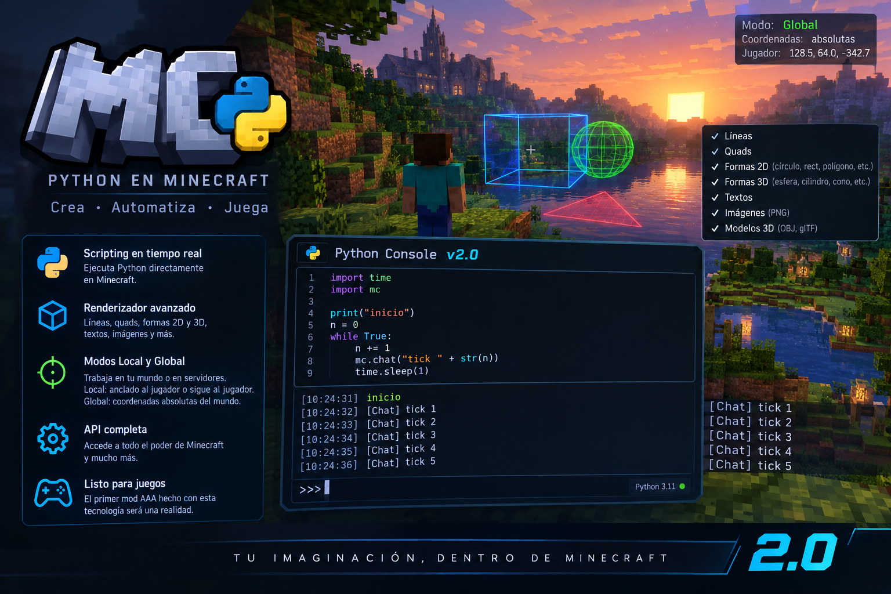

# MCODE 2.4.1

MCODE es un entorno de scripting para Minecraft Fabric con sintaxis inspirada en Python. El proyecto incluye editor persistente con pestañas, módulos locales por `SetPATH`, consola con historial, renderizador de formas del mundo, primitivas 2D/3D, importación estática de modelos Wavefront OBJ y paquetes de proyecto `.mcp`.

## Estado de MCODE 2.4.1

Esta versión corrige `mc.import_model`: ahora acepta las coordenadas `x`, `y`, `z` tanto posicionalmente como mediante argumentos keyword, y detecta coordenadas duplicadas con un mensaje explícito. El editor permite copiar toda la salida del búfer de consola al portapapeles con el botón **Copiar log** o `Ctrl+Shift+C`, para compartir errores completos al depurar.

Las primitivas 2D son polígonos en planos del mundo 3D, no un HUD fijo a pantalla. La importación actual admite geometría estática OBJ; texturas, materiales completos, rigging, animaciones, glTF y un HUD GUI programable siguen siendo pasos futuros. La modificación de bloques y entidades todavía no forma parte de una API pública general.

## Variables

Las variables se crean usando `=`.

```mcode
nombre = "Fernando"
edad = 18
altura = 1.71
activo = True
````

No es necesario declarar el tipo de variable.

## Tipos de datos

### Enteros

```mcode
edad = 18
vidas = 3
x = 100
```

### Decimales

```mcode
velocidad = 2.5
altura = 1.71
pi = 3.14159
```

### Booleanos

```mcode
activo = True
muerto = False
```

### Strings

Se pueden utilizar comillas simples o dobles.

```mcode
nombre = "Fernando"
mensaje = 'Hola'
```

Los strings admiten escapes:

```mcode
mensaje = "Hola\nMundo"
tab = "A\tB"
```

### None

Representa la ausencia de un valor.

```mcode
resultado = None
```

## Operadores matemáticos

### Suma

```mcode
resultado = 10 + 5
```

### Resta

```mcode
resultado = 10 - 5
```

### Multiplicación

```mcode
resultado = 10 * 5
```

### División

```mcode
resultado = 10 / 5
```

### División entera

```mcode
resultado = 10 // 3
```

### Módulo

```mcode
resultado = 10 % 3
```

### Potencia

```mcode
resultado = 2 ** 4
```

### Operadores en expresiones

```mcode
x = 10
y = 20

resultado = x + y * 2
```

Se pueden utilizar paréntesis para cambiar el orden:

```mcode
resultado = (10 + 5) * 2
```

## Comparaciones

```mcode
a = 10 == 10
b = 10 != 5
c = 10 < 20
d = 10 > 5
e = 10 <= 10
f = 10 >= 10
```

Las comparaciones producen `True` o `False`.

## Operadores lógicos

### `and`

```mcode
resultado = True and False
```

### `or`

```mcode
resultado = True or False
```

### `not`

```mcode
resultado = not True
```

También pueden combinarse:

```mcode
edad = 18
tiene_permiso = True

resultado = edad >= 18 and tiene_permiso
```

## Listas

Las listas utilizan `[]`.

```mcode
numeros = [10, 20, 30, 40]
```

Se puede acceder a un elemento mediante su índice:

```mcode
numeros = [10, 20, 30, 40]

primero = numeros[0]
segundo = numeros[1]
```

Los índices negativos empiezan desde el final:

```mcode
ultimo = numeros[-1]
```

Los elementos pueden modificarse:

```mcode
numeros = [10, 20, 30]

numeros[1] = 999
```

Las listas también pueden contener diferentes tipos:

```mcode
datos = [
    "Fernando",
    18,
    True,
    3.14
]
```

## Tuplas

Las tuplas utilizan `()`.

```mcode
posicion = (100, 64, 200)
```

Se puede acceder a sus elementos:

```mcode
x = posicion[0]
y = posicion[1]
z = posicion[2]
```

También pueden contener diferentes tipos:

```mcode
datos = ("Fernando", 18, True)
```

## Sets

Los conjuntos utilizan `{}` cuando contienen solamente valores separados por comas.

```mcode
numeros = {1, 2, 3, 4}
```

## Diccionarios

Los diccionarios utilizan pares `clave: valor`.

```mcode
jugador = {
    "nombre": "Fernando",
    "nivel": 10
}
```

Se accede a los valores mediante su clave:

```mcode
nombre = jugador["nombre"]
nivel = jugador["nivel"]
```

También pueden contener diferentes tipos:

```mcode
jugador = {
    "nombre": "Fernando",
    "nivel": 10,
    "activo": True
}
```

Los valores pueden modificarse:

```mcode
jugador["nivel"] = 11
```

## Función `print`

`print()` muestra valores en la salida del programa.

```mcode
print("Hola")
```

También puede mostrar variables:

```mcode
nombre = "Fernando"
print(nombre)
```

Y expresiones:

```mcode
x = 10
y = 20

print(x + y)
```

Se pueden imprimir listas, tuplas y diccionarios:

```mcode
numeros = [1, 2, 3]
print(numeros)
```

## Función `len`

Devuelve el tamaño de un valor compatible.

```mcode
nombre = "Fernando"

longitud = len(nombre)

print(longitud)
```

También puede utilizarse con listas:

```mcode
numeros = [10, 20, 30, 40]

cantidad = len(numeros)

print(cantidad)
```

## Función `type`

Devuelve el tipo de un valor.

```mcode
numero = 10
print(type(numero))
```

Ejemplos:

```mcode
print(type(10))
print(type(3.14))
print(type("Hola"))
print(type(True))
print(type(None))
```

## Conversión de tipos

### `int`

Convierte un valor a entero.

```mcode
numero = int("10")
```

### `float`

Convierte un valor a decimal.

```mcode
numero = float("3.14")
```

### `str`

Convierte un valor a texto.

```mcode
numero = 123
texto = str(numero)
```

### `bool`

Convierte un valor a booleano.

```mcode
valor = bool(1)
```

### `list`

Convierte un valor compatible en una lista.

```mcode
valores = list(...)
```

### `tuple`

Convierte un valor compatible en una tupla.

```mcode
valores = tuple(...)
```

### `set`

Convierte un valor compatible en un conjunto.

```mcode
valores = set(...)
```

## Funciones matemáticas

### `abs`

Devuelve el valor absoluto.

```mcode
numero = abs(-20)
```

### `round`

Redondea un número.

```mcode
numero = round(3.14)
```

### `min`

Devuelve el valor menor.

```mcode
numero = min(10, 5, 20)
```

### `max`

Devuelve el valor mayor.

```mcode
numero = max(10, 5, 20)
```

## Índices

Los strings, listas y tuplas pueden utilizar índices.

```mcode
texto = "Hola"

print(texto[0])
print(texto[-1])
```

```mcode
numeros = [10, 20, 30]

print(numeros[0])
print(numeros[-1])
```

Los elementos de una lista pueden modificarse mediante su índice:

```mcode
numeros = [10, 20, 30]

numeros[0] = 100
```

## Comentarios

Los comentarios comienzan con `#`.

```mcode
# Este es un comentario

x = 10 # También puede estar después del código
```

Todo lo que aparece después de `#` en una línea se considera comentario.

## Strings y operaciones

Los strings pueden concatenarse:

```mcode
nombre = "Fernando"
mensaje = "Hola " + nombre
```

También pueden repetirse:

```mcode
texto = "Hola " * 3
```

## Listas y operaciones

Las listas pueden concatenarse:

```mcode
a = [1, 2]
b = [3, 4]

resultado = a + b
```

También pueden repetirse:

```mcode
resultado = [1, 2] * 3
```

## Variables dentro de expresiones

Las variables pueden utilizarse entre sí:

```mcode
a = 10
b = 20
c = a + b
d = c * 2
```

El valor se calcula al ejecutar la expresión.

## Ejemplo completo

```mcode
# Datos del jugador

nombre = "Fernando"
nivel = 10
vida = 100
velocidad = 2.5
activo = True

posicion = [100, 64, 200]

print("Jugador:")
print(nombre)

print("Nivel:")
print(nivel)

print("Vida:")
print(vida)

print("Posición:")
print(posicion)

distancia = velocidad * 10

print("Distancia:")
print(distancia)

puede_jugar = activo and vida > 0

print("Puede jugar:")
print(puede_jugar)
```

## Sintaxis básica

La estructura general de una instrucción es:

```mcode
variable = valor
```

Los valores pueden ser:

```mcode
10
3.14
"Hola"
True
False
None
[1, 2, 3]
(1, 2, 3)
{1, 2, 3}
{"nombre": "Fernando"}
```

Y pueden combinarse mediante expresiones:

```mcode
resultado = (10 + 20) * 2
```

MCODE utiliza una sintaxis inspirada en Python, por lo que los programas se escriben de forma directa y con poca sintaxis adicional.

## Módulo mc (dibujo en el mundo)

```mcode
import mc
import time

mc.mode("global")  # coordenadas absolutas del mundo (solo en mundo local/LAN propio)
mc.color("red")
mc.width(3)
casa = mc.box(0, 70, 0, 4, 74, 4, fill=True, alpha=0.3)
linea = mc.line((0, 70, 0), (10, 80, 10), color="#00ff88")

x, y, z = mc.player_pos()
for i in range(100):
    casa.move(0.1, 0, 0)
    time.sleep(0.05)

mc.remove(linea)
mc.clear()
```

Funciones: `line`, `box`, `clear(group=)`, `remove`, `color`, `alpha`, `width`, `chat`, `say`, `mode`, `player_pos`.
Cada forma devuelve un objeto con `.remove()`, `.hide()`, `.show()`, `.color()`, `.alpha()`, `.width()`, `.fill()`, `.move(dx, dy, dz)` y `.id`.
Colores: nombre, `"#RRGGBB"` o tres valores 0-255. `alpha` va de 0 a 1.

## Primitivas 2D de MCODE 2.3.0

Las primitivas aceptan los planos `"xz"`, `"xy"` y `"yz"`. En `circle`, el plano se define alrededor del centro `(x, y, z)`. En `rect`, `(x, y, z)` es el centro y `width`/`height` son las dimensiones sobre el plano. Para `polygon` y `polyline`, se pueden usar puntos 2D junto con `plane` y `level`, o puntos XYZ completos.

```mcode
import mc
mc.mode("local", sigue=True)
mc.circle(0, 1.5, 5, 1.0, plane="xz", segments=32, color="cyan", fill=True, alpha=0.25)
mc.rect(0, 1.5, 5, 2.0, 1.0, plane="xz", color="orange", fill=True, alpha=0.25)
mc.polygon([[0, 4], [1, 5], [2, 4], [1, 3]], plane="xz", level=1.5, color="lime", fill=True)
mc.polyline([[-2, 4], [-1, 5], [0, 4]], plane="xz", level=1.5, color="yellow", width=3)
```

`segments` en `circle` debe estar entre 8 y 256. Los polígonos aceptan entre 3 y 128 puntos y deben ser un contorno simple sin autointersecciones. La triangulación rellena polígonos cóncavos cuando el contorno es válido.

## Ejemplos listos para probar

En `examples/` hay siete ejemplos: `01_2d_primitives.mcode` (primitivas planas en el mundo), `02_animation_and_handles.mcode` (animación con handles), `03_beacon_hunt_game.mcode` (balizas), `04_3d_primitives.mcode` (point/sphere/cylinder/cone/mesh), `05_animated_3d_frame.mcode` (animación 3D por frames), `06_frame_and_cleanup.mcode` (sin residuos al detener) y `07_3d_beacon_hunt.mcode` (minijuego 3D con récord local). Copia su contenido al editor o abre el archivo desde MCODE. Los dos juegos de balizas requieren mundo de un jugador porque usan coordenadas GLOBAL; no alteran bloques ni entidades.

## Ejecución

- Cada script se ejecuta en un hilo separado; las pestañas pueden ejecutar scripts de forma simultánea. El botón Ejecutar cambia a Detener mientras corre.
- Al terminar o detener un script, MCODE elimina las formas de esa ejecución sin borrar las formas de las demás pestañas.
- Usa `mc.begin_frame()` / `mc.end_frame()` en animaciones para sustituir la geometría anterior sin dejar residuos ni mostrar un frame vacío.
- Sin pausas (`time.sleep`) se permiten 25 millones de instrucciones o 10 s; `time.sleep` reinicia el presupuesto.
- Máximo 5000 formas y 200000 vértices visibles/en preparación.

## Modos LOCAL y GLOBAL (2.0)

Cada script corre en uno de estos dos modos. Se cambia con el botón **Local / Global** del editor o desde el propio script con `mc.mode("local")` / `mc.mode("global")` (por defecto: LOCAL).
En LOCAL, las coordenadas son relativas al jugador: X hacia su derecha, Y hacia arriba y Z hacia delante. `mc.mode("local")` fija posición y orientación en ese momento; `mc.mode("local", sigue=True)` hace que las formas nuevas sigan al jugador. Cada forma conserva el espacio y ancla con los que se creó, así que cambiar de modo no mueve las formas anteriores.
En GLOBAL, las coordenadas son posiciones absolutas del mundo. En un servidor multijugador, MCODE fuerza LOCAL y no permite acciones que envíen mensajes o comandos al servidor.

| | LOCAL | GLOBAL |
|---|---|---|
| Dibujar formas (`line`, `box`, ...) | sí | sí |
| `mc.chat(...)` (línea de chat que solo ves tú) | sí | sí |
| `mc.player_pos()` (lo que el cliente ya conoce) | sí | sí |
| `mc.say(...)` (envía chat o `/comandos` al servidor) | no | sí |

- En **servidores multijugador** el modo efectivo es siempre LOCAL. El botón queda desactivado y el editor muestra "Servidor: solo modo LOCAL". `mc.mode("global")` también se rechaza y registra un aviso en la consola.
- GLOBAL solo se activa en un mundo de un jugador (o abierto a LAN por ti).
- `mc.say("/time set day")` envía un comando (texto que empieza por `/`); cualquier otro texto se envía como mensaje de chat. Máximo unas 20 llamadas por segundo.
- `mc.mode()` devuelve `"local"` o `"global"` (el modo efectivo). `mc.mode("local", sigue=True)` configura el anclaje móvil; sin `sigue=True` el anclaje se queda fijo.
- Si un script llama a algo de GLOBAL estando en LOCAL, da un `RuntimeError` explicando cómo cambiar.

```mcode
import mc

if mc.mode() == "global":
    mc.say("/time set day")
else:
    mc.chat("Modo local: solo puedo dibujar y avisarte")
```

## Consola y `mc.chat`

Cada `mc.chat(...)` aparece localmente en el cliente y queda registrado en la consola del editor con hora (`[HH:mm:ss] [chat local] ...`). La consola conserva hasta 2000 líneas y sigue el final automáticamente mientras se mantiene abajo; puedes desplazarte hacia arriba para revisar mensajes anteriores. `mc.chat()` no envía mensajes al servidor. `mc.say()` sí puede enviar chat/comandos, pero requiere GLOBAL y queda bloqueado en multijugador.

```mcode
import time
import mc

print("inicio")
n = 0
while True:
    n += 1
    mc.chat("tick " + str(n))
    time.sleep(1)
```

## Abrir y guardar archivos

Los botones **Abrir** y **Guardar** usan los diálogos nativos de LWJGL TinyFD que acompaña a Minecraft 1.21.1. En Windows y macOS se emplea el selector nativo del sistema; en Linux TinyFD intenta utilizar el proveedor gráfico disponible, como `kdialog` en KDE Plasma o `zenity` en GNOME. En un escritorio KDE el selector puede integrarse con el flujo de archivos de Dolphin; no hace falta codificar Dolphin de forma fija.

Si el diálogo nativo no puede inicializarse, MCODE intenta el selector nativo de Java como alternativa. Si ambos fallan, el motivo aparece en la consola del editor en vez de desaparecer silenciosamente. Cancelar el diálogo no modifica el código actual. Los archivos se guardan como UTF-8 con extensión `.mcode`.

Si en Linux sigue sin abrirse el selector, comprueba que la sesión gráfica está activa y que tienes instalado un proveedor de diálogo como `kdialog` o `zenity`. Si la consola informa de un problema de TinyFD y el respaldo de Java, conserva ese mensaje para depurarlo.

## Compilar e instalar

No es necesario crear las carpetas `build/` ni `build/libs/` a mano: Gradle las genera solo después de completar una compilación correcta. Si el wrapper falla mientras descarga Gradle, la compilación ni siquiera ha comenzado y esas carpetas pueden no existir todavía.

- **Linux/macOS:** abre una terminal en la carpeta raíz del proyecto y ejecuta `chmod +x gradlew` (solo la primera vez) y después `./gradlew clean build`.
- **Windows:** abre CMD o PowerShell en la carpeta raíz del proyecto y ejecuta `gradlew.bat clean build`.

El archivo instalable se genera en `build/libs/textmenu-2.3.0.jar`. Copia ese JAR a la carpeta `mods` de la instancia de Minecraft 1.21.1 con Fabric. Antes de probar, elimina de `mods` cualquier JAR anterior con el mismo ID para evitar mods duplicados. Hace falta un JDK 21 instalado y disponible mediante `JAVA_HOME` o `PATH`.

### Solución al timeout descargando Gradle

El wrapper usa `gradle/wrapper/gradle-wrapper.properties`. El timeout de descarga está ampliado a 300000 ms (5 minutos). Esto evita fallar por pausas breves de una conexión lenta, pero no puede reparar una conexión caída o bloqueada. Si el mensaje vuelve a decir `Downloading ... gradle-8.14.3-bin.zip failed`, verifica que puedes abrir `https://services.gradle.org/distributions/gradle-8.14.3-bin.zip` en el navegador, desactiva temporalmente una VPN/proxy que esté interrumpiendo la conexión o prueba otra red. Vuelve a ejecutar el mismo comando; una vez que Gradle se descargue correctamente, las siguientes compilaciones reutilizarán la copia de la caché local.

Si después de descargar Gradle aparece un error distinto que menciona `Could not resolve`, `Could not find`, `compileJava` o una clase Java, ese ya será un fallo de dependencias o de código y habrá que revisar ese nuevo mensaje por separado.

El icono del mod está en `src/main/resources/assets/mcode/icon.png` (128x128); reemplaza ese archivo para poner el tuyo.

## Arte conceptual de MCODE 2.0

La carpeta `branding/` contiene una imagen conceptual de la visión del proyecto. Es material promocional para la dirección futura: los círculos, polígonos, texto en mundo, importación PNG/OBJ/glTF y otras funciones ilustradas todavía requieren implementar sus fases correspondientes. El icono real de Fabric sigue siendo `src/main/resources/assets/mcode/icon.png`, que puedes reemplazar por tu propio diseño.



## Compilar el proyecto (JDK 21 requerido)

Si ves `Unsupported class file major version 69`, Gradle se está ejecutando con Java 25. Usa JDK 21 para este proyecto; no cambies a Gradle 9 como primera solución, ya que el build utiliza Fabric Loom 1.9.2.

- Linux/macOS: `./build-linux-macos.sh`
- Windows: `build-windows.bat`

Consulta `SOLUCION_JAVA25.md` para instrucciones de instalación y diagnóstico. Tras `BUILD SUCCESSFUL`, el JAR instalable estará en `build/libs/`.


## Historial: MCODE 2.1.0 — sesiones persistentes, pestañas y rutas

- El editor conserva borradores y pestañas al cerrar con ESC, pulsar Cerrar o reabrir el editor. La sesión se guarda en `mcode/editor-session.dat`.
- Hay hasta 20 pestañas; `F5` ejecuta/detiene el script de la pestaña actual. Las ejecuciones iniciadas desde distintas pestañas pueden correr simultáneamente. La consola se comparte.
- Declara una ruta estable como primera línea física del archivo: `SetPATH home/hello`. No es una instrucción Python y debe ir en la línea 1. El archivo se guarda como `mcode/home/hello.mcode`. El path debe ser único por pestaña.
- Para importar un script por su path: `import home.hello`. Las variables y funciones exportadas por el módulo quedan disponibles como atributos del módulo.
- Si un script ya tiene `SetPATH`, Guardar escribe exactamente en esa ruta y no abre un selector para cambiarle el nombre. Si el archivo ya existe, pregunta antes de sobrescribirlo.
- Funciones de archivos dentro del workspace: `read_text(path)`, `write_text(path, contenido)`, `file_exists(path)`, `make_dirs(path)` y `list_files(path opcional)`. Las rutas son relativas al directorio `mcode` y no permiten escapar de él.

Ejemplo de dos scripts que comparten datos mediante un archivo:

```python
# primera línea en writer.mcode
SetPATH home/writer
write_text("shared/state.txt", "hola desde writer")
```

```python
SetPATH home/reader
import home.writer
print(read_text("shared/state.txt"))
```

Las funciones de archivos son para datos locales del cliente; no leen ni escriben archivos del servidor remoto. La comunicación mediante archivos compartidos requiere que ambos scripts usen la misma instancia local de MCODE.


## MCODE 2.3.0 — Fase 6: geometría 3D y limpieza de escenas

Esta versión añade primitivas 3D (`point`, `sphere`, `cylinder`, `cone` y `mesh`) además de transformaciones encadenables (`move`, `rotate`, `scale`, `reset_transform`). Las rotaciones usan grados y se aplican alrededor del centro de la forma.

Cada ejecución posee su propio conjunto de formas. Al finalizar o detener un script, MCODE retira automáticamente esas formas sin eliminar las de otras pestañas. `mc.clear()` limpia solo las formas de la ejecución actual; `mc.clear(all=True)` limpia toda la escena.

Para animaciones sin un frame vacío entre borrado y redibujado, usa el frame staging:

```python
import mc
import time

mc.mode("local", sigue=True)
phase = 0
while True:
    mc.begin_frame()
    orb = mc.sphere(0, 2, 4, 0.6, color="cyan", fill=True)
    orb.rotate(0, phase, 0)
    mc.end_frame()
    phase += 4
    time.sleep(0.05)
```

`mc.begin_frame()` empieza un frame invisible temporal y `mc.end_frame()` sustituye las formas de esa ejecución de forma atómica. Cada iteración debe cerrar el frame. Si el script se detiene o termina, también se descarta cualquier frame temporal abierto.

### API 3D

- `mc.point(x, y, z, size=0.12, color="yellow")`: marcador cúbico pequeño.
- `mc.sphere(x, y, z, radius, segments=16, rings=10, fill=True)`.
- `mc.cylinder(x, y, z, radius, height, segments=16, fill=True)`; `y` es la base.
- `mc.cone(x, y, z, radius, height, segments=16, fill=True)`; `y` es la base y la punta está en `y + height`.
- `mc.mesh(vertices, faces, fill=True)`: vértices XYZ y caras con índices desde cero.
- En cualquier handle: `.move(dx,dy,dz)`, `.rotate(rx,ry,rz)` en grados, `.scale(s)` o `.scale(sx,sy,sz)` y `.reset_transform()`.

El dibujo 2D actual es un conjunto de primitivas planas dibujadas **en el mundo 3D** sobre los planos `xz`, `xy` y `yz`; todavía no es un sistema de dibujo 2D de interfaz (GUI/HUD). Esa será una fase separada.

### Pestañas

Cada pestaña visible tiene un botón `×`. Si hay cambios sin guardar, se pregunta si deseas guardar antes de cerrar; responder No descarta cambios. La última pestaña no se puede cerrar. `Ctrl+W` también solicita cerrar la pestaña actual.


## MCODE 2.4.0 — Modelos y proyectos

- Importa modelos estáticos Wavefront OBJ desde Blender con `mc.import_model(...)`.
- Usa **Recursos** dentro del editor para copiar modelos al workspace, importar/exportar proyectos `.mcp` o consultar la ayuda integrada.
- Usa `‹` / `›` en la barra de pestañas, `Ctrl+Tab` / `Ctrl+Shift+Tab` o `Ctrl+PageUp` / `Ctrl+PageDown` para navegar entre hasta 20 pestañas.
- Los nombres de pestaña provienen del archivo o del tramo final de `SetPATH`.
- Los literales `true` y `false` se normalizan a `True` y `False` al escribirlos o pegarlos; el intérprete también los acepta en minúsculas.
- `examples/MCODE_demo_project.mcp` es un paquete de prueba que puedes importar directamente desde el botón Recursos. Contiene dos scripts y un modelo OBJ de muestra.

Consulta `SOLUCION_OBJ_Y_PROYECTOS.md`, `CHANGELOG_2.4.0.md` y `CHANGELOG_2.4.1.md` para detalles.


## MCODE 2.4.1 — Corrección de OBJ y depuración de consola

- `mc.import_model(path, x, y, z, ...)` acepta hasta cuatro argumentos posicionales (`path`, `x`, `y`, `z`), así como las coordenadas por nombre. `scale`, `axis`, `color` y `fill` se pasan por keyword. Si se repite `x`, `y` o `z`, se muestra un `TypeError` descriptivo.
- El botón `Copiar log` copia todo el registro retenido de la consola (hasta su límite de historial), incluida la línea parcial actual, al portapapeles del sistema.
- Atajo `Ctrl+Shift+C`: copiar salida de consola.
- El mensaje de confirmación se añade después de copiar, por lo que no aparece dentro del propio texto que acabas de copiar.
